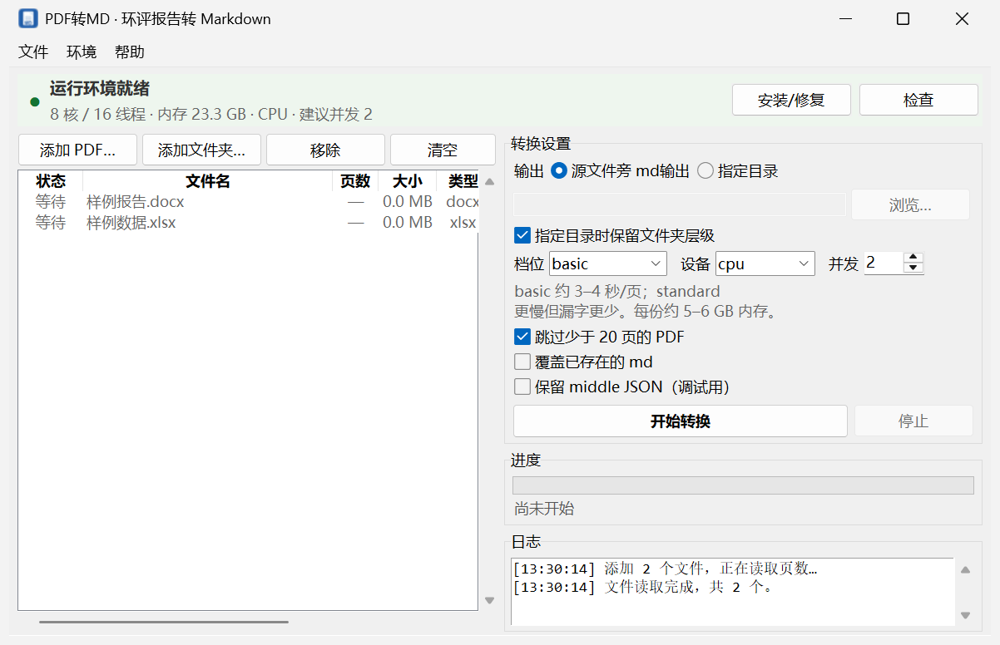
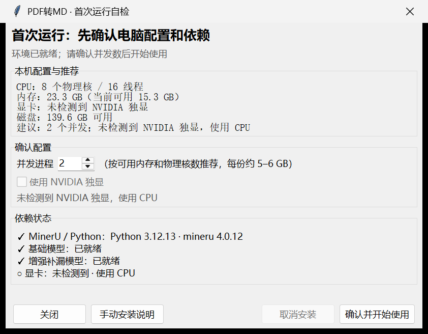
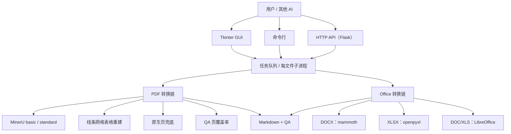
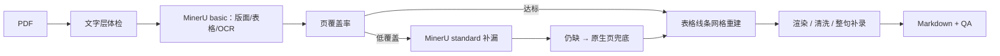
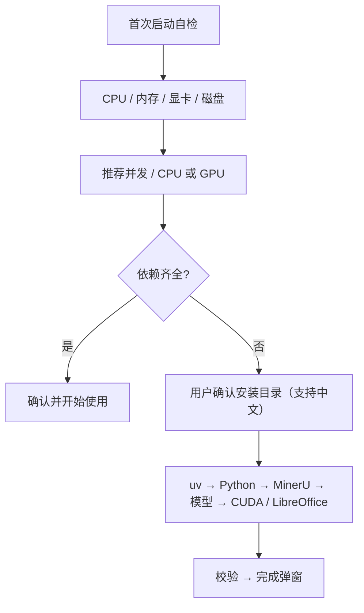

# PDF转MD · 环评报告专用（pdf2md-eia）

把**中文环评报告、工程报告、Office 文档**转成 AI 可读的 Markdown。  
重点不是“把字提出来”，而是**把复杂表格、合并单元格、扫描件、漏字页、页码锚点和质量指标一起做对**。

- 图形界面 + 命令行 + HTTP API
- 首次运行自检，自动安装 Python / MinerU / 模型 / CUDA / LibreOffice
- 全程本地处理，装好后可离线
- 支持中文路径



<p align="center"><i>主界面：文件队列、输出设置、并发/设备、进度与日志</i></p>



<p align="center"><i>首次运行：自检 CPU / 内存 / 显卡 / 磁盘，给出并发建议，依赖已就绪时只确认、不重复安装</i></p>

---

## 支持哪些格式

| 格式 | 引擎 | 输出 | 说明 |
|---|---|---|---|
| **PDF** | MinerU basic + 线条网格表格重建 + standard 补漏 + 原生兜底 | `.md` + `_qa.json` | 核心能力；支持扫描件 OCR、复杂表、合并单元格、页码锚点 |
| **DOCX** | mammoth → HTML → Markdown | `.md` + `_qa.json` | 标题、段落、表格；表格保留 HTML 合并单元格，不走 MinerU，秒级完成 |
| **XLSX** | openpyxl | `.md` + `_qa.json` | 按工作表转 Markdown 表；合并单元格填入左上角值；公式读缓存值 |
| **DOC** | LibreOffice → DOCX → mammoth | `.md` + `_qa.json` | 旧版 Word；首次使用会提示自动安装 LibreOffice |
| **XLS** | LibreOffice → XLSX → openpyxl | `.md` + `_qa.json` | 旧版 Excel；同上 |
| PPTX | — | — | 暂不支持，可在后续版本增加 |

几个约定：

- **少于 20 页跳过**只对 PDF 生效；Office 文件不按页数跳过。
- DOCX/XLSX 里的图片暂不做 OCR，只提取可读文字和表格。
- 旧版 DOC/XLS 的质量取决于本机 LibreOffice。
- Office 文件没有页码锚点，QA 里 `pages=0`，`tables_md`、`sheets` 等字段仍然有效。

更细的格式约定见 [docs/FORMATS.md](docs/FORMATS.md)。

---

## 和市面上常见转换工具的区别

先说结论：**本项目不是通用文档转换器的替代品**，它只把“中文环评/工程报告”这一件事做深：
复杂表结构、扫描件、漏字页、页码锚点、质量报告、图形界面和一键依赖安装。

| 能力 | 本项目 | MarkItDown | MinerU 原版 | Docling | Pandoc | PyMuPDF4LLM / pdfplumber | Marker | 在线转换 |
|---|---|---|---|---|---|---|---|---|
| 主要定位 | 环评 PDF/Office → AI Markdown | 通用文件 → Markdown | PDF 版面/OCR/表格引擎 | 通用文档理解 | 文档格式互转 | PDF 文字/表格提取 | PDF → Markdown | 网页端转换 |
| 中文复杂表 | **强**（线条网格重建） | 弱 | 中（原表可能打散多行单元格） | 中 | — | 弱（规则猜表） | 中 | 参差 |
| 合并单元格 | **HTML rowspan/colspan + 逻辑网格** | 弱 | 部分 | 部分 | — | 弱 | 部分 | 参差 |
| 扫描件 OCR | **支持** | 不支持/有限 | **支持** | 支持 | 不支持 | 不支持 | 支持 | 支持 |
| 页码锚点 | **有** `<!-- p123 -->` | 无 | 无 | 无 | 无 | 无 | 部分 | 无 |
| 质量 QA | **有**（页覆盖率/漏字页/表格数） | 无 | 无 | 无 | 无 | 无 | 无 | 无 |
| Office 格式 | **DOCX/XLSX/DOC/XLS** | 支持很多格式 | 主要 PDF | 支持 | **强** | 不支持 | PDF | 支持 |
| GUI / 自动装依赖 | **有** | 无 | 无 | 无 | 无 | 无 | 无 | 有 |
| 离线 | **装好后完全离线** | 可 | 可 | 可 | 可 | 可 | 可 | 需上传 |
| HTTP API | **有** | 无 | 有 | 有 | 无 | 无 | 无 | 无 |
| 成本 | 本地 CPU 可跑 | 低 | 本地 CPU/GPU | 本地 | 极低 | 极低 | 常需 GPU | 订阅/限次 |

定性对比，版本变化很快，建议以各项目最新文档为准。详细对比见 [docs/COMPARISON.md](docs/COMPARISON.md)。

### 更具体地说

- **MarkItDown**：微软的通用文件 → Markdown 工具，格式覆盖广、上手快；但它不是为“跨行跨列 + 整页外框 + 跨页续表”的中文环评表设计的，也没有页级质量指标。
- **MinerU 原版**：本项目的 PDF 主引擎。它能把版面、表格区域、公式、扫描件识别出来；但多行单元格常被按视觉行打散（例如 `石油烃（C10-C40）` 变成 `（石C10油-C烃40）`）。本项目在它之上做了**真实线条网格重建**、standard 补漏、原生页兜底和 QA。
- **Docling**：通用文档理解能力强，表格模型也不错；但不针对环评表、没有本项目的 GUI/一键安装/页覆盖率 QA。
- **Pandoc**：Office → Markdown 非常成熟；但它不处理 PDF 版面、扫描件和复杂表。
- **PyMuPDF4LLM / pdfplumber**：文字层提取快，表格靠规则推断；遇到复杂环评表会串列，本项目早期版本已经踩过这个坑。
- **Marker**：PDF → Markdown 效果好，但通常依赖 GPU，部署和调参成本更高，也不是环评场景专用。
- **在线转换**：方便，但要上传文件，隐私和合规风险高，通常没有 API、页级 QA 和离线能力。

---

## 快速开始

### 方式 A：源码运行 GUI（推荐开发/内网使用）

环境：Windows 10/11 x64、Python 3.12。

```bat
git clone https://github.com/sheep-gy/pdf2md-eia.git
cd pdf2md-eia

uv venv --python 3.12 .venv
uv pip install -r requirements.txt --python .venv\Scripts\python.exe

.venv\Scripts\python.exe cli.py
```

`cli.py` 不带参数会打开 GUI。首次启动会自检；缺少 MinerU/模型时，按弹窗提示选安装目录并点一次“开始安装并配置”，程序会自动下载：

- uv（若系统没有）
- Python 3.12 / MinerU / pymupdf / pdfplumber
- 基础模型 + 增强模型
- NVIDIA CUDA 后端（检测到独显时）
- LibreOffice（第一次转旧版 DOC/XLS 时）

### 方式 B：构建 Windows 桌面版 exe

```bat
rem 1. 准备 uv.exe（仓库不提交 67 MB 的二进制）
rem    下载 uv-x86_64-pc-windows-msvc.zip，解压出 uv.exe 放到 tools\

rem 2. 安装打包工具
D:\mineru_env\Scripts\python.exe -m pip install pyinstaller

rem 3. 构建
D:\mineru_env\Scripts\python.exe build_gui.py
```

产物：`dist\PDF转MD\PDF转MD.exe`（onedir，需和 `_internal\` 一起分发）。  
本仓库只含源码与文档，不包含 224 MB 的运行时和 2 GB 模型。

### 命令行

```bat
PDF转MD.exe capabilities
PDF转MD.exe version

PDF转MD.exe convert "某报告.pdf" -o "输出目录" --device auto --tier basic
PDF转MD.exe convert "某文件.docx" -o "输出目录"
PDF转MD.exe convert "某文件.xlsx" -o "输出目录"
PDF转MD.exe batch "报告目录" -o "输出目录" --pattern "" --workers 2
```

### HTTP API

```bat
PDF转MD.exe serve --host 0.0.0.0 --port 8765 --token 你的密钥
```

```bash
curl -s http://127.0.0.1:8765/capabilities
curl -s -X POST http://127.0.0.1:8765/convert \
  -H "Authorization: Bearer 你的密钥" \
  -H "Content-Type: application/json" \
  -d '{"path":"D:/报告/某项目.pdf","device":"auto","tier":"basic"}'
curl -s http://127.0.0.1:8765/jobs/<job_id>
curl -s -o result.md http://127.0.0.1:8765/jobs/<job_id>/download
```

`/capabilities` 会返回：

```json
"params": {
  "device": ["auto", "cpu", "cuda"],
  "tier": ["basic", "standard", "advanced"],
  "pages": "all 或 1-5,8（仅 PDF）",
  "formats": ["pdf", "docx", "doc", "xlsx", "xls"]
}
```

调用前先看 `gpu.backend_ready`，不要凭“有显卡”就传 `cuda`。详见 [AI调用说明.md](AI调用说明.md) 和 [docs/API.md](docs/API.md)。

---

## 架构



PDF 主链路：



首次安装：



### 实现要点

**PDF**
1. **MinerU basic** 负责版面、表格区域、公式、OCR 兜底。
2. 用 PDF **真实线条**重建表格网格：按交点建网格，内部线缺失推断 `rowspan/colspan`。
3. 单元格文字用 PyMuPDF `clip` 取，上下标不被打散，复选框保留。
4. 页级覆盖率体检：低覆盖页用 **standard** 重跑；仍缺则**原生页兜底**。
5. 清洗、压缩 token、删除重复页眉/水印、加 `<!-- p123 -->` 页码锚点。
6. 输出 `_qa.json`：平均/最低页覆盖率、低于 0.9 的页数、表格数、私用区乱码残留。

**Office**
- DOCX：mammoth 转 HTML，再转 Markdown；表格保留 HTML，合并单元格不丢。
- XLSX：openpyxl 按 sheet 遍历，合并区域填左上角值，输出管道表。
- DOC/XLS：LibreOffice headless 转 DOCX/XLSX，再走上面的流程。

**GUI / 任务**
- Tkinter 单窗口；每份文件一个子进程，进度写 `progress.jsonl`。
- 停止 = `taskkill /F /T` 杀进程树，5 秒内生效；窗口关闭时会清理子进程。
- 并发按可用内存和物理核数建议，最大 3。

**安装器**
- uv → venv → pip（阿里云 → 清华 → 官方 PyPI）→ 模型（ModelScope → HuggingFace）→ CUDA/LibreOffice → 校验。
- 每步有“正在下载 / 已下载多少 / 正在安装”的进度；可取消，已完成步骤保留。
- 已就绪时不再询问安装位置。

更详细的设计、表格重建算法和 QA 字段见 [docs/ARCHITECTURE.md](docs/ARCHITECTURE.md)。

---

## 输出与 QA

每份文件生成：

```
文件名.md        正文，带 <!-- p123 --> 页码锚点
文件名_qa.json   质量报告
```

QA 示例：

```json
{
  "pages": 218,
  "avg_page_recall": 0.9967,
  "min_page_recall": 0.9665,
  "pages_below_0.9": 0,
  "tables_md": 150,
  "pua_left": 0
}
```

使用建议：

- `min_page_recall < 0.90` 的页建议人工抽检。
- 需要严格字段抽取时，先用 `skill/pdf-to-md-eia/scripts/expand_tables.py` 把 HTML 合并表展开成每行带完整列值的 TSV。
- 不要把 500 页报告一次性塞进上下文，按章节/页码切片。

---

## 离线使用

- **转换本身完全离线**：PDF 本地 MinerU，Office 本地解析/LibreOffice，不上传。
- **首次安装依赖需要联网**：Python/MinerU、模型、CUDA、LibreOffice。
- 离线部署：在联网机器上把安装目录设成与离线机器相同的路径，装好后把 `PDF转MD_桌面版\` 和运行时目录按原路径拷贝；venv 脚本记录绝对路径，换路径可能失效。详见 [docs/OFFLINE.md](docs/OFFLINE.md)。

---

## 给其他 AI 用

包根目录/仓库包含：

- [AI调用说明.md](AI调用说明.md)：最短调用步骤
- [API接口.md](API接口.md)：HTTP 字段
- [skill/pdf-to-md-eia/SKILL.md](skill/pdf-to-md-eia/SKILL.md)：触发条件、GPU 判断、质量红线
- `skill/pdf-to-md-eia/references/`：api / gui / gpu / installation
- `skill/pdf-to-md-eia/scripts/pdf2md_client.py`：Python 客户端

---

## 目录结构

```
pdf2md-eia/
├─ cli.py                 # 统一入口：GUI / convert / batch / serve / capabilities
├─ convert.py             # PDF 转换主链路
├─ office_convert.py      # DOCX / XLSX / DOC / XLS
├─ job_child.py           # GUI/API 的单文件子进程
├─ batch.py               # 批量转换
├─ server.py              # HTTP API
├─ gui/                   # Tkinter 界面、安装向导、任务队列
├─ eia_md/                # 表格重建、文字提取、渲染、GPU 检测
├─ assets/PDF转MD.ico     # 图标
├─ skill/pdf-to-md-eia/   # 随包分发的 AI skill
├─ examples/              # DOCX/XLSX 示例
├─ docs/                  # 架构、格式、对比、离线、API
├─ build_gui.py           # PyInstaller 构建脚本
├─ PDF转MD.spec           # onedir 打包配置
├─ requirements.txt
└─ LICENSE
```

---

## 已知限制

- 扫描件 OCR 质量取决于扫描清晰度；建议对关键数据表抽检。
- 极复杂公式仍可能有符号偏差。
- DOCX/XLSX 里的图片不做 OCR。
- 旧版 DOC/XLS 依赖 LibreOffice。
- PPTX 暂不支持。
- 桌面版主要面向 Windows 10/11；源码中的 CLI/API 可跨平台，但 MinerU/一键安装按 Windows 设计。
- CPU 全量转换较慢（basic 约 3–4 秒/页），大语料建议按省份/批次跑。

---

## License

[MIT](LICENSE)
