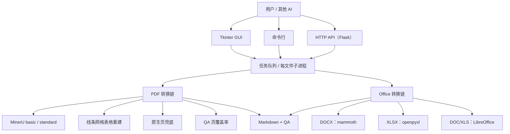
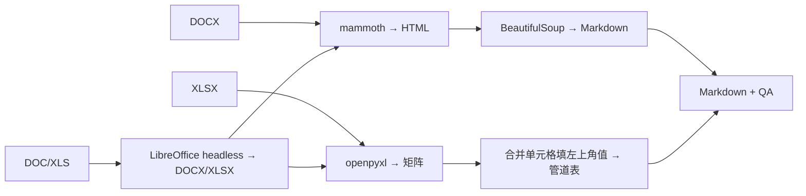
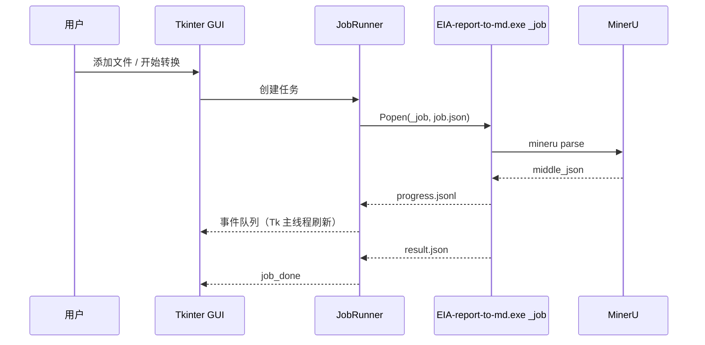
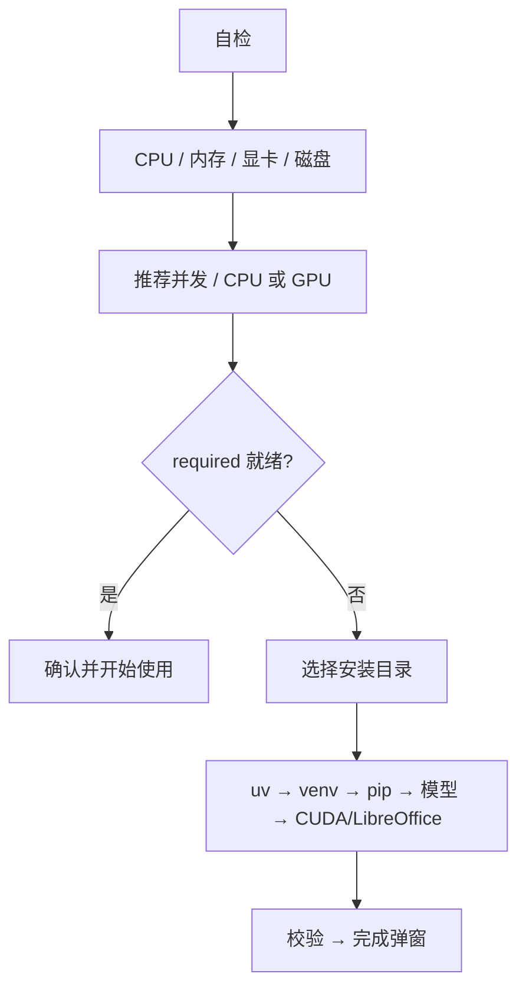

# 架构与实现原理

本文说明 `pdf2md-eia` 的分层、PDF/Office 两条转换链、表格重建、QA、GUI 任务模型和安装器。
代码入口：`cli.py`；PDF 主链路：`convert.py`；Office：`office_convert.py`。

---

## 1. 总览



模块职责：

| 模块 | 职责 |
|---|---|
| `cli.py` | 统一入口：无参数进 GUI；`convert` / `batch` / `serve` / `capabilities` / `_job` |
| `convert.py` | PDF 转换主链路：探测、MinerU、补漏、原生兜底、渲染、QA |
| `office_convert.py` | DOCX/XLSX/DOC/XLS 转换；`convert_any` 统一分发 |
| `job_child.py` | GUI/API 的单文件子进程；进度写 `progress.jsonl`，结果写 `result.json` |
| `gui/` | 主窗口、环境检查、安装向导、任务队列、配置、平台工具 |
| `eia_md/` | 表格重建、单元格取字、原生页渲染、Markdown 渲染、GPU 检测 |
| `batch.py` | 批量转换，保留目录层级，可断点续跑 |
| `server.py` | Flask API：`/capabilities`、`/convert`、`/jobs/...` |
| `build_gui.py` / `EIA-report-to-md.spec` | PyInstaller onedir 打包 |

---

## 2. PDF 主链路


### 2.1 文字层体检与 OCR 模式

`native_page_set()` 逐页统计文字层字符数：

- 字符数 ≥ 50 的页视为“有文字层”；
- 若 90% 以上页面有文字层，MinerU 用 `--ocr-mode txt`（快）；
- 否则用 `--ocr-mode auto`，让 MinerU 对扫描页走 OCR。

### 2.2 MinerU basic

调用：

```bat
mineru parse input.pdf -o mid.json --tier basic --pages all --ocr-mode auto --format middle_json
```

basic 负责版面、表格区域、公式和 OCR 兜底。输出是 `middle_json`，保留每个 block 的 bbox 和类型。

### 2.3 页覆盖率与 standard 补漏

`repair_pages()` 对每页做字符种类覆盖率：

```
recall(page) = |PDF 文字层字符集 ∩ Markdown 字符集| / |PDF 文字层字符集|
```

- 只看字符种类，避免重复页眉把召回拉低；
- 文字层 ≥ 50 字符、覆盖率 < 0.95 的页进入补漏；
- 最多 80 页，连续页合并成区间，一次 `--tier standard` 调用；
- 补漏结果替换 `middle_json` 中对应页。

standard 是 VLM 档，CPU 上约 30–40 秒/页；它只用于少数漏字页，不用于整份文档。

### 2.4 原生页兜底

补漏后仍低覆盖的页，`native_overrides()` 会：

1. 用 pdfplumber 检查真实线条；表格带太多的页不强行重排；
2. 用 PyMuPDF 原生文字层重新排正文；
3. 只有覆盖率比当前高 2% 以上才替换。

这样避免“为了 1% 的提升把表格排乱”。

### 2.5 表格线条网格重建

这是与“直接用 MinerU 原表”最大的区别。

1. 用 MinerU 的表格 bbox 定位表格，避免把正文框进来；
2. 在 bbox 内读 PDF 的真实线条（横线/竖线）；
3. 按线条交点建网格；
4. 内部线缺失时推断 `rowspan` / `colspan`；
5. 单元格文字用 PyMuPDF `clip` 取，保留上下标、复选框；
6. 字符召回校验，低于阈值自动回退 MinerU 原表。

结果输出为 HTML `<table>`，保留 `rowspan/colspan`；AI 需要严格字段抽取时，可用 `skill/pdf-to-md-eia/scripts/expand_tables.py` 展开成每行带完整列值的 TSV。

### 2.6 渲染与清洗

`eia_md/render.py` 把 `middle_json` 渲染成 Markdown：

- 标题层级、段落、列表；
- 表格块用 HTML；
- 每页加 `<!-- p123 -->` 页码锚点；
- 简单表转管道表，省 token；
- 图片只保留图题，不嵌二进制；
- 删除重复页眉/水印，续表标注表名。

`eia_md/clean_table.py` 会把误吞进单元格的正文拆出来。

### 2.7 整句补录与 QA

`recover_sentences()` 把仍然缺失的完整句子追加到页末，标记 `<!-- 补录 -->`。

`qa_doc()` 输出：

| 字段 | 含义 |
|---|---|
| `pages` | PDF 总页数 |
| `avg_page_recall` | 平均页覆盖率 |
| `min_page_recall` | 最差页覆盖率 |
| `pages_below_0.9` | 低于 0.9 的页数 |
| `tables_mid` / `tables_md` | MinerU 表格块数 / 输出表格数 |
| `chars` | Markdown 字符数 |
| `suspicious_cells` | 可疑单元格数 |
| `pua_left` | 私用区乱码残留 |
| `mineru_sec` / `total_sec` | 解析/总耗时 |
| `repaired_pages` / `native_pages` / `recovered_pages` | 补漏/原生/补录页 |

---

## 3. Office 链路



### DOCX

- 优先 `mammoth.convert_to_html()`；对 `Title`/`Subtitle` 做 style map；
- 用 BeautifulSoup 把 h1–h6、p、ul/ol、blockquote、pre、table 转成 Markdown；
- 表格保留 HTML，合并单元格不丢；
- mammoth 失败时回退 `python-docx` 按 body 顺序遍历段落和表格；
- 图片暂不 OCR，只保留 alt 文本。

### XLSX

- `openpyxl.load_workbook(data_only=True)`；
- 每个 sheet 一个 `## 工作表名`；
- 合并区域填左上角值；
- 单元格值转义 `|` 和换行，输出 Markdown 管道表；
- 公式读缓存值（文件需在 Excel 中保存过）。

### DOC/XLS

- `LibreOffice --headless --convert-to docx/xlsx`；
- 使用独立 `-env:UserInstallation` profile，避免和用户正在开的 LibreOffice 抢锁；
- 转换后复用 DOCX/XLSX 流程；
- 未安装 LibreOffice 时给出明确错误，GUI 提供自动安装入口。

---

## 4. GUI 与任务模型



- Tk 主线程只做 UI；后台线程/子进程通过 `queue.Queue` 回传事件；
- 每个文件一个子进程，崩溃不带走 GUI；
- 进度写 `progress.jsonl`，不依赖 stdout（窗口化 exe 的 stdout 为 None）；
- 停止用 `taskkill /F /T` 杀进程树，5 秒内生效；
- 并发按可用内存（每进程约 2.5–3 GB）和物理核数建议，最大 3；
- 只有一个 PDF 且页数 ≥20 时，按内存自动拆成 2–3 路 MinerU 分页并行，
  合并时按 `page_idx` 排序；缺页/子进程失败会自动回退整本单路解析；
- 多路时按 `物理核数 ÷ 总路数` 设置 `MINERU_INTRA_OP_NUM_THREADS`，
  避免每个进程都开 4 线程导致超卖；
- 配置在 `%LOCALAPPDATA%\PDF2MD\config.json`，日志在 `logs\`，任务临时目录在 `jobs\`。

---

## 5. 首次安装器



步骤：

1. **uv**：`tools/uv.exe` → 配置/PATH/常见路径 → 下载官方 zip → winget；
2. **venv**：优先系统 Python 3.12/3.11/3.10；没有则 `uv venv --python 3.12`；
3. **pip**：`mineru>=4.0,<5` + `pymupdf` + `pdfplumber`；GPU 时 `mineru[full]`；
4. **模型**：basic → standard；ModelScope → HuggingFace → auto；
5. **CUDA**：`mineru[full]`，校验 `torch.cuda.is_available()` + `lmdeploy`；
6. **LibreOffice**：旧版 DOC/XLS 需要时用 winget 安装；
7. **校验**：Python 依赖、`mineru-kit`、模型 verify、GPU。

镜像顺序：阿里云 → 清华 → 官方 PyPI。每步有进度事件，可取消；已完成步骤保留。

---

## 6. HTTP API

- Flask；内存任务字典 + 线程池；
- `/health`、`/capabilities`、`/convert`、`/jobs/<id>`、`/jobs/<id>/result`、`/jobs/<id>/download`；
- 启动时 `--token` 或 `PDF2MD_TOKEN`；`Authorization: Bearer` / `X-API-Token`；
- `/capabilities` 返回 GPU、推荐参数、支持格式；
- 详见 [API.md](API.md)。

---

## 7. 性能与内存

| 场景 | 参考速度 |
|---|---|
| PDF basic（CPU） | 2.5–4 秒/页 |
| PDF standard 补漏 | 30–40 秒/页 |
| DOCX | 秒级 |
| XLSX | 秒级 |
| 每进程内存 | basic 10 页峰值约 2.7 GB；按 2.5–3 GB/路估算 |
| 单文件分页并行 | ≥20 页自动拆 2 路；20 页实测 102s → 54s，输出一致 |

23 GB 内存（当前可用约 8.5 GB）建议 2 个并发；16 GB 建议 1–2；8 GB 建议 1。
AMD / Intel 集显不支持 MinerU 的 CUDA 后端，只能使用 CPU；NVIDIA 独显且
`torch.cuda.is_available()` 为 true 时才建议 `cuda`。

---

## 8. 安全与离线

- 默认全程本地处理；转换过程不上传；
- 只有首次安装依赖时联网（PyPI/ModelScope/HuggingFace/winget）；
- API 建议只在局域网使用，必须设 token；
- 装好后可完全离线；离线部署注意事项见 [OFFLINE.md](OFFLINE.md)。

---

## 9. 已知限制

- 扫描件 OCR 质量取决于扫描清晰度；
- 极复杂公式仍可能有符号偏差；
- DOCX/XLSX 图片不做 OCR；
- 旧版 DOC/XLS 依赖 LibreOffice；
- PPTX 暂不支持；
- 桌面版主要面向 Windows 10/11。
